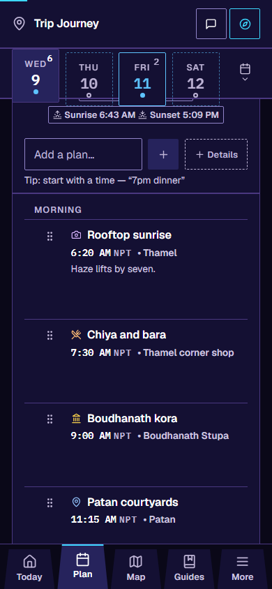
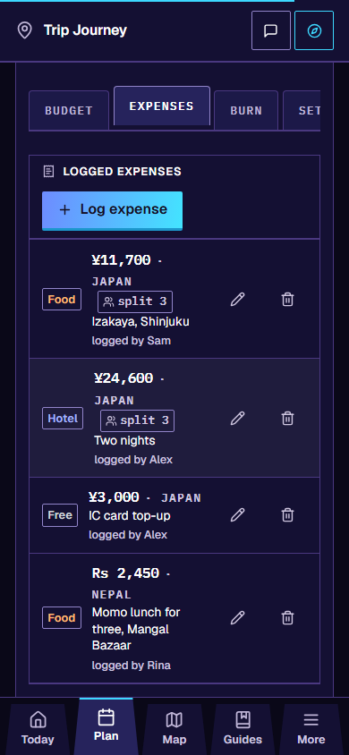
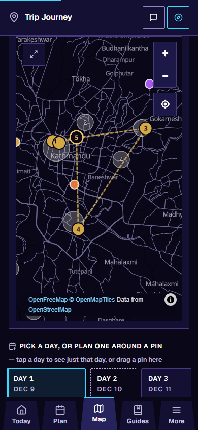

# Trip Planner

An offline-first trip planner that installs as a PWA. It keeps a whole trip in one place: a
countdown, a day-by-day itinerary, guides, a map, a journal, expenses and travel documents. Data
lives on the device first and syncs across phones through Firestore when you sign in. It was built
for a 32-day Nepal and Japan trip, which ships as the built-in sample; you can create your own
trips from dates and destinations.

**Live demo:** https://powan55.github.io/trip_planner/

<p>
  
  
  
</p>

## Features

- Countdown home that switches to a day-by-day travel mode once the trip starts
- Itinerary planner with timed plans sorted into morning, afternoon and evening, plus a quick-add
  button on phones
- Guides for places, food, photography and nightlife, with search and filters
- MapLibre map on OpenFreeMap tiles (no API key) with category filters and an itinerary overlay
- Journal, expense log with settle-up, packing list, document checklist and a shared-links inbox;
  photos are stored in IndexedDB
- Multiple trips: create one, join one with an invite, switch between them
- Optional AI concierge that answers questions about the trip and proposes plan changes, which are
  applied only after you confirm
- Works offline after the first visit; a new version shows an update prompt instead of reloading
- Dark theme, keyboard and screen-reader support, and `prefers-reduced-motion` honoured throughout

## Tech stack

- Next.js 16.3 (App Router, static export), React 19.3, TypeScript 6
- Tailwind CSS 3 with shadcn/ui on Radix UI, Framer Motion 12
- MapLibre GL 6, date-fns 4, Zod 4
- Firebase 12: Firestore for sync, Firebase Auth for accounts
- Vitest 5 and Playwright 1.63 for tests

## Architecture

- **Static site.** `next build` exports to `trip/out/` and GitHub Pages serves it. There is no app
  server.
- **Service worker.** `trip/scripts/gen-sw.mjs` writes a hand-rolled `sw.js` at build time that
  precaches the app shell and every route, so the app keeps working with no connection.
- **Local first.** Every domain reads and writes through one storage gateway
  (`trip/core/storage/gateway.ts`) backed by `localStorage`, with IndexedDB for photos. Sync is a
  layer on top: changes go into an outbox and are pushed to Firestore when the build has a
  Firebase config and the user is signed in. Without a config the app is fully local.
- **Access control.** `firestore.rules` is the whole access model: everything requires auth, and a
  trip with a members list is readable and writable only by its members. The rules are tested
  against the real rules engine in the Firestore emulator on every push.
- **Concierge.** The chat calls a Cloudflare Worker kept in a separate private repo. The Worker
  verifies the user's Firebase sign-in and trip membership, and is rate limited. The client
  renders nothing unless the build sets `NEXT_PUBLIC_CONCIERGE_URL`.

## Testing

- 3,666 unit tests in 355 files (Vitest)
- 774 end-to-end cases across 112 spec files (Playwright), run against the built static export in
  Chromium, two iPhone viewports and WebKit, including axe accessibility scans and reduced-motion
  checks
- Visual regression against committed screenshot baselines
- Firestore rules checks in the emulator, with negative controls that prove each guard is load
  bearing

## CI and releases

Every pull request into `dev` runs type checks, lint, unit tests, the build, the rules emulator
check, the browser suite and visual regression. `dev` merges into `main` through a reviewed pull
request; a release gate checks that the version was bumped and that `trip/docs/RELEASES.md` has an
entry for it. A push to `main` deploys to Pages, tags the version and publishes a GitHub Release.
The workflow is described in [CONTRIBUTING.md](CONTRIBUTING.md).

## Running locally

```bash
cd trip
npm ci --legacy-peer-deps     # the flag is needed: a few deps still declare React 18 peers
npm run dev                   # http://localhost:3000
npm test                      # unit tests
npm run build:e2e && npm run test:e2e   # browser suite; it serves out/, so build first
```

The service worker only registers in production builds. To try sync, copy
`trip/.env.local.example` to `trip/.env.local` and fill in a Firebase web config.

## Credits

Built by Laxmi Poudel ([Powan55](https://github.com/Powan55)).

Destination photos under `trip/public/images/` are from Wikimedia Commons under their own
licences, listed in the [image credits](trip/public/images/CREDITS.md). Map label glyphs in `trip/public/font/` are Noto Sans
under the SIL Open Font License 1.1.

## License

Source code is MIT licensed, see [LICENSE](LICENSE). Images and fonts are not covered by it.
